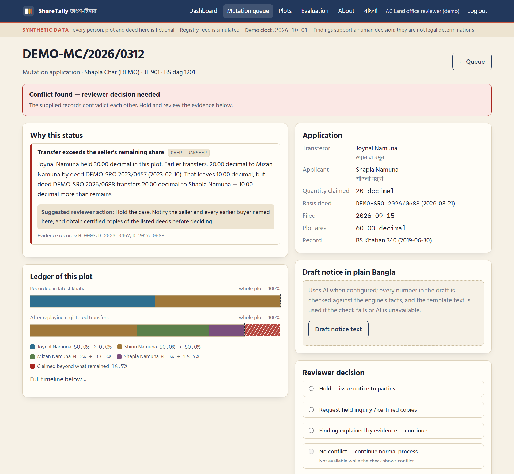
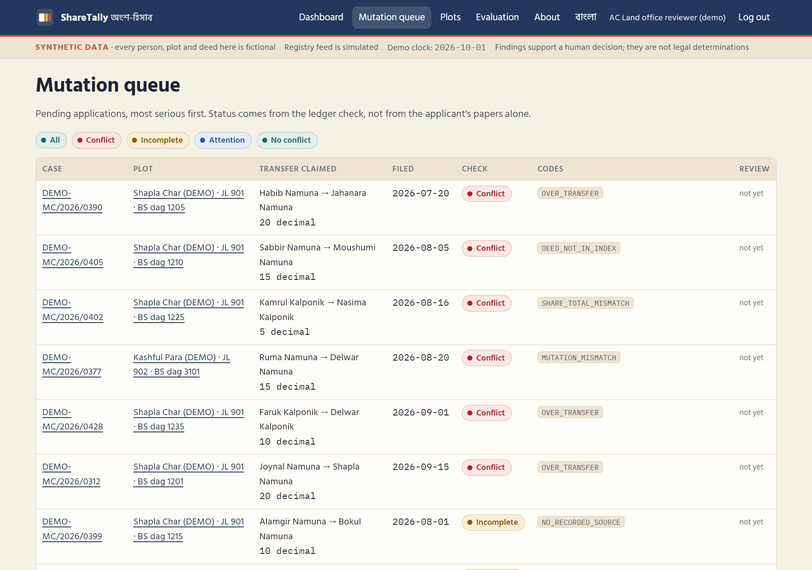
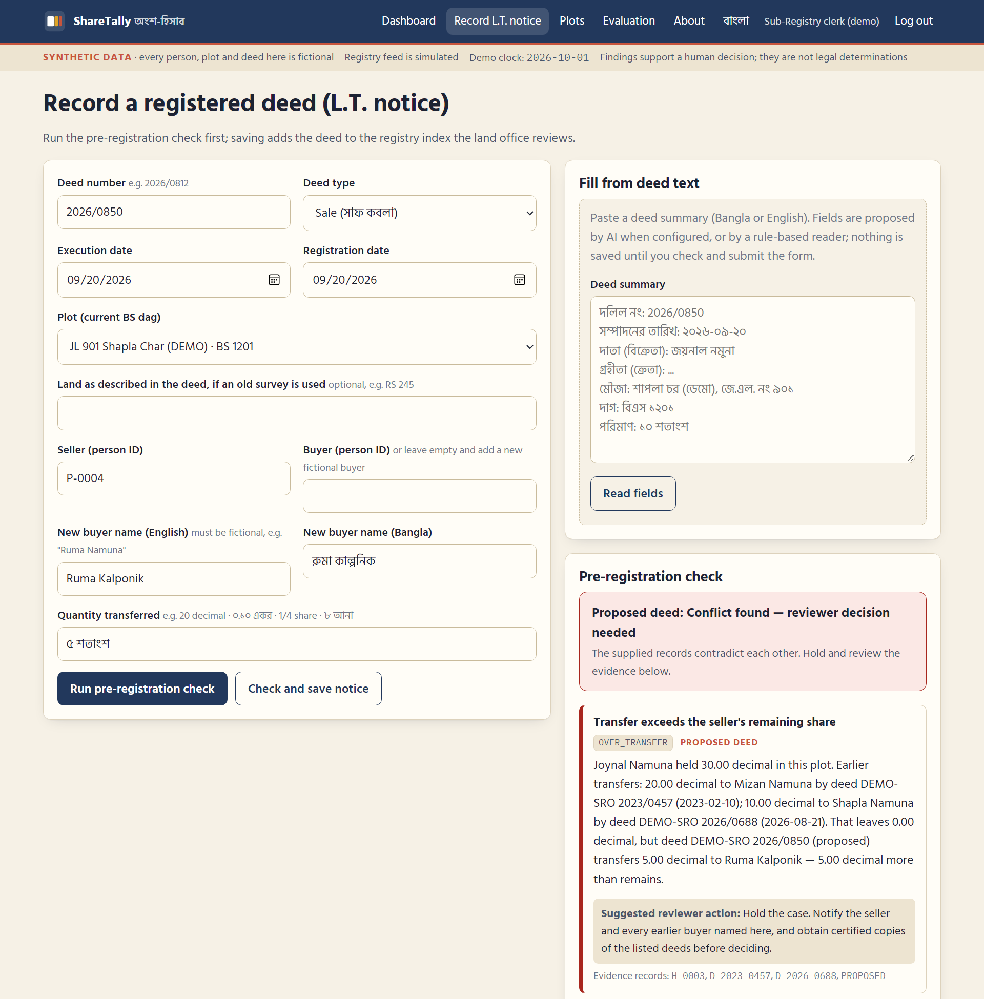
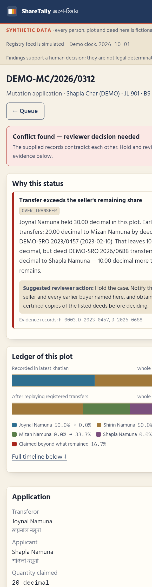

# ShareTally (অংশ-হিসাব)

**Catching double sales by tallying every share before mutation.**

ShareTally keeps an exact running balance of who holds how much of each plot (dag). It replays every registered transfer on top of the latest khatian, so the AC (Land) reviewer sees a second sale, a sale beyond one's share, or a mutation that cites a non-existent deed before the record of rights is changed — even while the khatian is still out of date. When the records are not enough to tell, it says **Incomplete**, never "clean".

LandTech 2026 · Track: Digital Land Records, Verification & Digitization · **Problem statement P3 — Fraud & Double-Selling Detection** · submission label LA-60

> Prototype. **All data is synthetic.** The registry feed, offices and accounts are simulated; no government system is accessed. Findings support a human decision and are not legal determinations of ownership.



---

## The problem in one paragraph

Deeds are registered at Sub-Registry offices (Law Ministry); the khatian is updated by mutation at AC (Land) offices (Ministry of Land). A sale deed can be registered when the seller appears in the latest khatian and swears they have not already transferred the property (Registration Act 1908, s.52A). If the first buyer has not completed mutation, the khatian still shows the seller, so a second deed for the same share passes the same test — and its buyer may reach the mutation desk first. The Sub-Registrar already has to send a Land Transfer (L.T.) notice for every registered transfer, and the land office has to open a mutation file when it receives one (State Acquisition and Tenancy Act 1950, ss. 89 and 143C). ShareTally turns those notices into an arithmetic check.

## How it works

```
latest khatian shares ─┐
registered transfers ──┤   exact share ledger          findings + evidence        reviewer decides
 (digital L.T. notices)├─► (fractions, oldest first, ─► CONFLICT / INCOMPLETE / ─► hold & notice, inquiry,
succession records ────┤    earlier deeds keep         ATTENTION / NO_CONFLICT     explained, proceed
mutation applications ─┤    priority)                  per plot and per case       (logged, hash-chained)
index coverage dates ──┘
```

1. **Baseline.** Start from the holders and shares recorded for the dag (anna notation, decimal shares, acres, decimals and configured local units are all converted to exact fractions).
2. **Replay.** Apply every registered transfer and inheritance after the record date, oldest first. Earlier transfers keep priority (the principle in Transfer of Property Act 1882, s.48).
3. **Conserve.** Nobody can pass on more than they hold. A deed that asks for more raises `OVER_TRANSFER`, citing the khatian entry and every earlier deed.
4. **Cross-check.** A mutation application must cite a deed that exists in the registry index and matches it (parties, date, quantity).
5. **Refuse to guess.** If the digital index does not cover the whole period, a unit such as bigha has no local definition, heir shares do not add up, or a deed names an old-survey dag that split into several plots, the result is **Incomplete**.

### Worked example (scenario S02, all fictional)

| Record | Content |
| --- | --- |
| BS Khatian 340 (2019-06-30), Shapla Char (DEMO) JL 901, BS dag 1201, 60 decimal | Joynal Namuna ৮ আনা (1/2), Shirin Namuna ৮ আনা (1/2) |
| Deed DEMO-SRO 2023/0457 (2023-02-10) | Joynal → Mizan Namuna, 20 decimal. **Never mutated.** |
| Deed DEMO-SRO 2026/0688 (2026-08-21) | Joynal → Shapla Namuna, 20 decimal |
| Mutation case DEMO-MC/2026/0312 (filed 2026-09-15) | Shapla applies on the basis of deed 2026/0688 |

Output for the case (demo clock 2026-10-01):

> **Conflict found — reviewer decision needed** · `OVER_TRANSFER`
> Joynal Namuna held 30.00 decimal in this plot. Earlier transfers: 20.00 decimal to Mizan Namuna by deed DEMO-SRO 2023/0457 (2023-02-10). That leaves 10.00 decimal, but deed DEMO-SRO 2026/0688 transfers 20.00 decimal to Shapla Namuna — 10.00 decimal more than remains.
> *Suggested reviewer action:* Hold the case. Notify the seller and every earlier buyer named here, and obtain certified copies of the listed deeds before deciding.

The plot also shows `RECORD_LAG`: deed 2023/0457 was registered 1,329 days earlier and no approved mutation reflects it. A check of the khatian alone would have cleared this case.

## Quick start

Requires Python 3.11 or newer (tested on 3.14.6, Windows 11).

```bash
python -m venv .venv
.venv/Scripts/python -m pip install -r requirements-dev.txt      # macOS/Linux: .venv/bin/python
.venv/Scripts/python -m uvicorn sharetally.web:app --port 8765
```

Open <http://localhost:8765>. On first start the app creates `data/sharetally.db` and fills it with the synthetic dataset. Delete that file to reset the demo.

```bash
.venv/Scripts/python -m pytest              # 51 tests: units, engine, workflow, security
.venv/Scripts/python scripts/evaluate.py    # regenerates docs/evaluation.md
.venv/Scripts/python scripts/export_dataset.py   # writes data/synthetic_dataset.json for inspection
.venv/Scripts/python scripts/snapshot.py    # regenerates docs/img/*.png (needs Edge or Chrome)
```

### Demo accounts (synthetic prototype only)

| Role | Username | Password | Can do |
| --- | --- | --- | --- |
| AC (Land) office reviewer | `reviewer.demo` | `review-demo-2026` | Mutation queue, case review, decisions, notice drafts |
| Sub-Registry clerk | `clerk.demo` | `clerk-demo-2026` | Record L.T. notices, pre-registration check, deed-text reader |
| Auditor (read-only) | `auditor.demo` | `audit-demo-2026` | Everything read-only, audit-log verification |

Change all three with `SHARETALLY_PW_*` environment variables before any public deployment (see `.env.example`).

## User workflow

1. **Clerk (Sub-Registry):** opens *Record L.T. notice*, optionally pastes a deed summary to pre-fill the form, runs the **pre-registration check** (nothing is stored), then saves the notice. The deed joins the registry index the land office sees.
2. **Reviewer (AC Land office):** opens the **mutation queue**, sorted conflict → incomplete → attention → no conflict. Each case shows why, with evidence records, a share strip, the full timeline and a suggested action. The reviewer records a decision with a reason; "no conflict — proceed" is disabled while the check shows a conflict or incomplete records.
3. **Auditor:** reads everything and verifies the hash-chained audit log.

| Mutation queue | Pre-registration check | Phone view |
| --- | --- | --- |
|  |  |  |

## Architecture

```
Browser (server-rendered pages, vanilla JS, strict CSP)
   │  HTTPS, session cookie + CSRF token
FastAPI app  sharetally/web.py ── roles, validation, pages, JSON API
   ├─ engine/units.py     exact parsing: decimal, acre, ojutangsho, anna-gonda-kora-kranti-til, local katha/bigha
   ├─ engine/ledger.py    the ledger and every rule (pure functions, no I/O)
   ├─ repository.py       SQLite rows → engine inputs (incl. old-survey crosswalk)
   ├─ explain.py          deterministic English + Bangla wording
   ├─ ai.py               optional Claude calls, fact-checked, with rule-based fallback
   ├─ security.py         PBKDF2 passwords, sessions, CSRF, login throttling
   └─ audit.py            append-only SHA-256 hash chain
SQLite  data/sharetally.db  (seeded from sharetally/synthetic.py, fixed seed)
```

**Data model:** `mouza`, `plot` (dag), `holding` (khatian entry: person, share), `deed` + `deed_item` (registry index / L.T. notice: seller, buyer, quantity, plot or old-survey reference), `crosswalk` (old dag → current plots), `inheritance` + `heir` (succession record fractions), `mutation_case`, `coverage` (period the digital index covers per mouza), `local_unit`, `review`, `audit_log`, `app_user`, `session`, `login_attempt`, `expected` (declared scenario results).

**Endpoints**

| Method | Path | Role | Purpose |
| --- | --- | --- | --- |
| GET | `/dashboard`, `/plots`, `/plots/{id}`, `/evaluation`, `/about` | any signed-in | Pages |
| GET | `/cases`, `/cases/{id}` | reviewer, auditor | Mutation queue and case review |
| POST | `/cases/{id}/decision` | reviewer | Record decision (CSRF) |
| GET/POST | `/intake` | clerk | L.T. notice form, pre-registration check, save (CSRF) |
| GET | `/audit` | auditor | Audit log and chain verification |
| GET | `/api/plots/{id}/ledger` | any signed-in | Ledger JSON |
| GET | `/api/cases` | reviewer, auditor | Queue JSON |
| POST | `/api/check` | clerk, reviewer | Check a proposed transfer, nothing stored |
| POST | `/api/assist/explain` | reviewer | Notice draft (AI or template) |
| POST | `/api/assist/extract` | clerk | Fields from pasted deed text (AI or rules) |
| GET | `/api/evaluation`, `/api/audit/verify`, `/healthz` | signed-in / auditor / public | Evaluation, chain check, health |

### Rule catalogue

| Code | Level | Meaning |
| --- | --- | --- |
| `OVER_TRANSFER` | conflict | A transfer exceeds what the seller still holds (beyond recorded share, or after earlier transfers) |
| `DEED_NOT_IN_INDEX` | conflict | Mutation cites a deed absent from an index that covers its date |
| `MUTATION_MISMATCH` | conflict | Mutation differs from the cited deed (seller, buyer, date, quantity or plot) |
| `SHARE_TOTAL_MISMATCH` | conflict | Recorded shares add up to more than the whole plot |
| `COVERAGE_GAP` | incomplete | The digital index does not cover part of the period since the record date |
| `CITED_DEED_UNVERIFIABLE` | incomplete | Cited deed is older than the digital index |
| `NO_RECORDED_SOURCE` | incomplete | Seller (or deceased) holds nothing in the supplied records |
| `AMBIGUOUS_REFERENCE` | incomplete | Deed names an old-survey dag that maps to several current plots |
| `UNIT_UNRESOLVED` | incomplete | Katha/bigha without a configured local definition |
| `INHERITANCE_SHARES_INCOMPLETE` | incomplete | Heir fractions on the succession record do not add up to 1 |
| `UNALLOCATED_SHARE` | incomplete | Part of the plot has no recorded holder |
| `INVALID_QUANTITY` | incomplete | A quantity could not be read |
| `RECORD_LAG` | attention | A registered transfer has no approved mutation after 90 days: the khatian is stale |
| `RAPID_RESALE` | attention | Resold within 90 days of acquiring; context only, never a conflict by itself |

Quantities written with decimals get a rounding allowance of half the last stated digit (at least 0.005 decimal), so "16.67 decimal" for a one-third share of 50 decimal is not reported as an over-sale.

## Data sources

**Demo data — synthetic, created by us.** `sharetally/synthetic.py` (seed 2026) builds 3 fictional mouzas (JL 901–903, suffixed "(DEMO)"), 49 plots, 163 fictional people, 62 deeds, 61 mutation cases and 2 succession records: 18 hand-written scenarios with expected results declared next to the data, plus 30 generated clean plots. Every name carries an obvious marker — Namuna (sample), Kalponik (fictional), Udahoron (example), Porikkha (test), Kritrim (synthetic) — and the intake form refuses new names without one. `data/synthetic_dataset.json` is an export for inspection.

**No real data.** No real person's data, no real land record, no government portal scraping, querying or bulk download, and no access to any live system. Security testing was done only against this prototype.

**Public sources read to understand the workflow** (no data imported). Pages were fetched on 15 Oct 2026; the team should re-check legal citations with mentors before relying on them.

| Source | Used for |
| --- | --- |
| State Acquisition and Tenancy Act 1950, s.89 (L.T. notice) and s.143C (mutation file on notice) — <https://bdlaws.minlaw.gov.bd/act-241/section-7068.html>, <https://bdlaws.minlaw.gov.bd/act-241/section-7261.html> | The existing legal feed ShareTally digitises |
| Registration Act 1908, ss. 47 and 52A — <https://bdlaws.minlaw.gov.bd/act-print-90.html> | Today's safeguard: latest khatian + seller's affidavit; 25-year ownership description |
| Transfer of Property Act 1882, s.48 — <https://bdlaws.minlaw.gov.bd/act-print-48.html> | Priority of earlier transfers (ordering rule) |
| Land Crimes Prevention and Remedy Act 2023 (Act 36 of 2023), ss. 4–5 — <https://bdlaws.minlaw.gov.bd/act-print-1454.html> | Selling beyond one's ownership and forging documents are offences |
| Land Development Tax Act 2023 (Act 31 of 2023) — <https://bdlaws.minlaw.gov.bd/act-print-1449.html> | Context: electronic tax collection |
| Ministry of Land portal — <https://land.gov.bd/> (e-mutation, DLRMS records, hotline 16122) | Existing services; what already exists |
| Prothom Alo, 28 Sep 2022 — <https://www.prothomalo.com/bangladesh/p2gxq4yra9> | e-mutation target 28 days; 43-day average |
| Behavioural Insights Team, 20 Aug 2020 — <https://www.bi.team/?p=11734> | ~30% of new owners applied for mutation within 3 months (2018 trial, 46 upazilas) |
| The Daily Star, 7 Feb 2026 — <https://www.thedailystar.net/supplements/your-property-guru/news/messy-reality-bangladeshs-online-land-registration-4100206> | Registration–mutation coordination gap |
| TBS, 9 Nov 2020 and 30 Jun 2026 — <https://www.tbsnews.net/bangladesh/land-mutation-be-automatic-public-sufferings-go-155716>, <https://www.tbsnews.net/node/1475871> | Automatic mutation approved in 2020; integration still described as a plan in 2026 |
| Ittefaq, 18 Jul 2026; Dhaka Times, 3 Jun 2026 | Mutation attempts on forged deeds caught (or reversed) by manual review |
| Tumkur district (Karnataka) — <https://tumkur.nic.in/en/stamps-and-registration/> (updated 7 Mar 2025); Telangana Act 9 of 2020 | Precedents: registration checked against land records elsewhere |
| landregistrationbd.com (updated 23 Jul 2025); legalseba.com | Anna–gonda–kora conversions; local units (secondary sources, disputed ratios flagged) |

Full research notes, including what could not be verified, are in [docs/idea-selection.md](docs/idea-selection.md).

## Evaluation (synthetic, honest)

From `python scripts/evaluate.py` on a fresh copy of the dataset (demo clock 2026-10-01):

| Measure | Result |
| --- | ---: |
| Declared status and finding codes matched (plots + cases) | 70 / 70 |
| Clean background plots wrongly flagged | 0 / 30 |
| Incomplete-data objects reported as clean | 0 / 13 |
| Flags citing at least one source record | 27 / 27 |
| A khatian-only check would have cleared these problem cases | 8 / 12 |
| Slowest single-plot ledger | < 1 ms |

The expectations were declared before the engine ran, but by the same people who wrote the rules, so this shows the mechanism behaves as designed — **not** real-world accuracy. Real records will produce more Incomplete results and some false conflicts (for example unregistered family partitions). Next steps: blind scenarios written by a mentor, then anonymised organizer-approved samples. Details: [docs/evaluation.md](docs/evaluation.md).

## Security (on our own prototype only)

- PBKDF2-SHA256 (600,000 iterations) password hashes; server-side sessions (random token, stored hashed; HttpOnly, SameSite=Lax, Secure on HTTPS).
- CSRF tokens on every state change; login form uses a double-submit token.
- Role checks on every page and API route; the auditor is read-only.
- Login throttling: 5 failures in 15 minutes per username and per IP.
- Parameterised SQL; auto-escaped templates; Content-Security-Policy without inline scripts; `X-Frame-Options: DENY`; `no-store` on dynamic pages.
- Input validation: deed number format, dates within the demo clock, known persons and plots, readable quantities, fictional-name rule.
- Hash-chained audit log; reviewer decisions store the engine status and version at that moment and a hash of the note.
- `tests/test_security.py` checks all of the above, including tampering with an audit row.

Known gaps: no MFA, no rate limit on read endpoints, SQLite single-node; the audit chain detects edits but someone with full database access could rebuild it unless the head hash is published or printed regularly.

## AI tool disclosure

**Used to build this project.** Claude Code (Anthropic, model Claude Opus 5.5) was used on 15 October 2026 to research public sources, compare candidate ideas, and draft most of the code, tests, synthetic data and documentation in this repository from the team's brief. The design decisions, rules and wording are documented here so that both students can explain them. *[TEAM: describe what you reviewed, changed and tested yourselves before submitting — the rule book requires both students to be able to explain the code.]*

**Used inside the app (optional).** With `ANTHROPIC_API_KEY` set, the app calls a Claude model (default `claude-opus-5-5`, effort `low`, server-side refusal fallback enabled) for two narrow tasks:

1. *Notice draft:* rewrites the engine's findings as a short Bangla + English notice. People are replaced by tokens before sending; the draft is rejected and the deterministic template used instead if it contains any number not in the engine's facts, any unknown person, or accusatory words (fraud, forgery, জাল …).
2. *Deed-text reader:* proposes form fields from pasted deed text. Person and plot IDs are matched by the app, not the model, and nothing is saved until the clerk checks and submits the form.

The engine's statuses never depend on AI. Without a key, a template and a rule-based reader are used; the demo runs fully offline.

## Limitations

- It checks consistency of the records it is given. It does not decide ownership, validate title, or label anyone fraudulent.
- Value depends on a complete digital feed of registered transfers. Today L.T. notices are largely paper; historical deeds before digitisation produce Incomplete results until backfilled (for example through P1-style digitisation).
- Unregistered arrangements (oral partition among heirs, possession) are invisible and may appear as conflicts; the reviewer can record "explained by evidence".
- Inheritance fractions are taken from the succession record; the engine does not compute faraid or other personal-law shares.
- Katha, bigha and the kora → kranti → til ratios vary or are disputed between sources; they are configuration for a land officer or mentor to confirm.
- The old-survey crosswalk is a lookup table; real dag mapping needs mouza maps and a surveyor.
- Synthetic evaluation only (see above).

## Deployment

`render.yaml` describes a free Render web service (`uvicorn ... --proxy-headers`). Render's free instances sleep after 15 minutes without traffic and take about a minute to wake; the filesystem is ephemeral, so the demo database resets on restart (a feature for a demo). Set `SHARETALLY_PW_*` secrets in the dashboard; `ANTHROPIC_API_KEY` is optional. Any host that runs `uvicorn sharetally.web:app` works.

## Repository layout

```
sharetally/            application package (engine, web, templates, static)
tests/                 pytest suite (51 tests)
scripts/               evaluate.py, export_dataset.py, snapshot.py
data/                  synthetic_dataset.json export (the live DB is git-ignored)
docs/                  idea selection, submission text, concept note, demo script, plan, deck, evaluation
```

## Credits and licences

FastAPI (MIT), Starlette (BSD-3-Clause), Uvicorn (BSD-3-Clause), Jinja2 (BSD-3-Clause), python-multipart (Apache-2.0), Anthropic Python SDK (MIT), pytest (MIT). Fonts: Hind Siliguri and IBM Plex Mono via Google Fonts (SIL Open Font License 1.1). ShareTally itself is released under the MIT licence (see `LICENSE`).

## Team

| Role | Name |
| --- | --- |
| Student | Tanvir Hossin *(confirm role: team leader?)* |
| Student | [NAME] |
| Faculty mentor | [NAME, DEPARTMENT] |
| Industry mentor | [NAME, ORGANISATION] |

## Changes since Round 1

*To be filled before the Final Round (required by rule book §7.5).*
