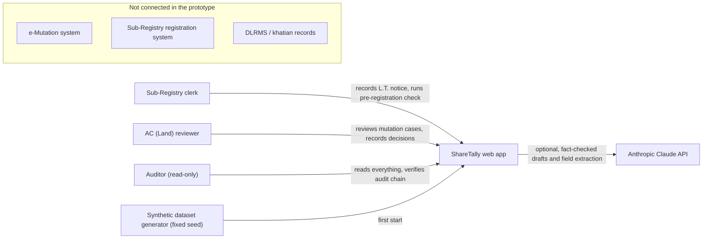
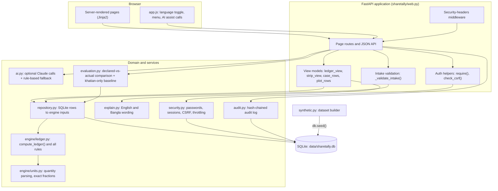
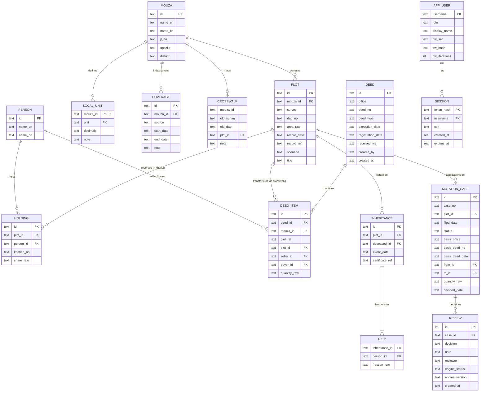
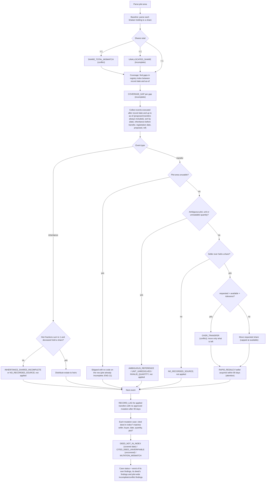
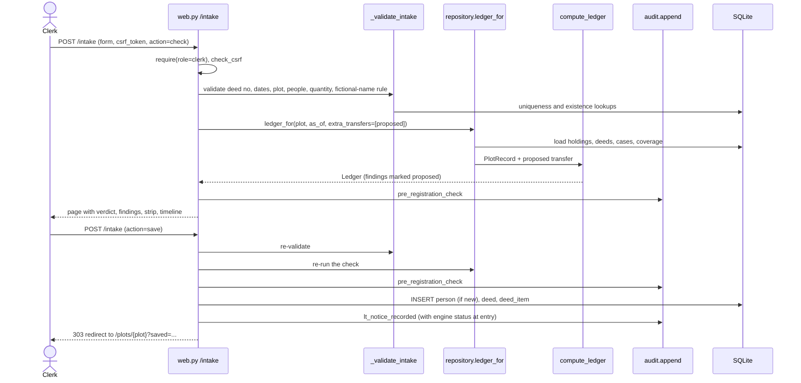
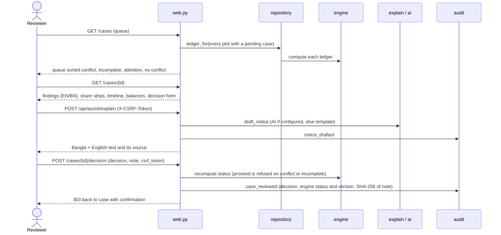
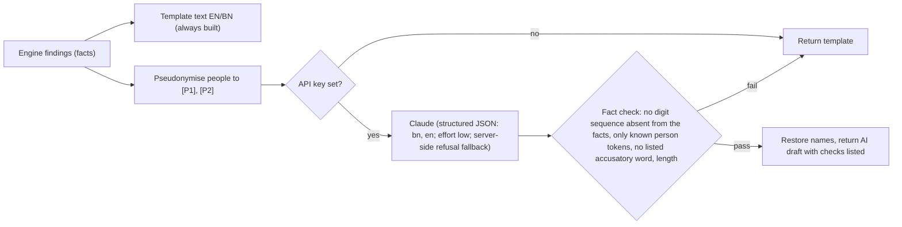
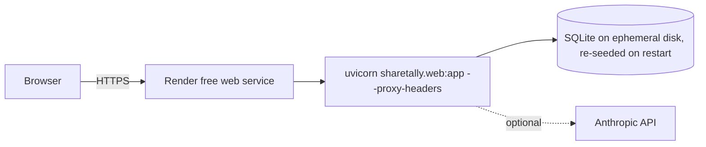

# ShareTally architecture (as built, Round 1)

This document describes the prototype exactly as it is in the repository (engine v0.1.0). The improvement architecture and roadmap are in [improvement-architecture.md](improvement-architecture.md); the decisions behind both are recorded in [adr/](adr/).

Contents: [1 Context](#1-system-context) · [2 Components](#2-components) · [3 Data model](#3-data-model) · [4 Ledger engine](#4-ledger-engine) · [5 Request flows](#5-request-flows) · [6 Security model](#6-security-model) · [7 AI assistance](#7-ai-assistance) · [8 Configuration](#8-configuration) · [9 Deployment](#9-deployment) · [10 Testing and evaluation](#10-testing-and-evaluation) · [11 Known limits](#11-known-limits-of-the-as-built-design)

---

## 1. System context

ShareTally sits between the two offices that today do not reconcile their records: the Sub-Registry office that registers deeds and the AC (Land) office that updates the khatian through mutation. In the prototype the registry feed is simulated: the clerk screen and the synthetic dataset stand in for digital Land Transfer (L.T.) notices.

Nothing in the prototype calls a government system, and no endpoint accepts a notice from one: L.T. notices enter only through the clerk's HTML form. The JSON API (section 5) offers read access and a pre-registration check that stores nothing. It is unversioned and its OpenAPI document has no request schemas (audit WEB-9), so an integration contract is still to be written.

## 2. Components

| Module | Lines | Responsibility | Depends on |
| --- | ---: | --- | --- |
| `engine/units.py` | 187 | Parse "20 decimal", "০.১০ একর", "1/3 share", "৫ আনা ১০ গণ্ডা", configured katha/bigha into `Quantity(kind, value, tolerance, raw)`; formatting helpers | standard library only |
| `engine/ledger.py` | 533 | Input/output dataclasses and `compute_ledger(plot, as_of, registry_lookup)`; every rule | `units.py` |
| `repository.py` | 120 | Build `PlotRecord` from SQLite (holdings, transfers incl. crosswalk, inheritances, mutation cases, coverage, local units); `ledger_for()` | `sqlite3`, `engine.ledger` |
| `db.py` | 150 | Schema DDL, connection, `seed()` | `sqlite3` |
| `synthetic.py` | 376 | Deterministic dataset: 18 scenarios with declared expectations + 30 clean background plots | `units.py` |
| `evaluation.py` | 121 | Compare engine output with declared expectations; khatian-only baseline | `repository`, `units` |
| `explain.py` | 234 | Status, title, action and description text in English and Bangla | `ledger.Finding`, `units` |
| `ai.py` | 244 | Notice drafting and deed-text extraction via the Anthropic SDK, with fact check and rule-based fallback | `anthropic` (optional), `units` |
| `security.py` | 98 | PBKDF2 hashing, demo users, sessions, CSRF comparison, login throttling | `sqlite3` |
| `audit.py` | 49 | Append and verify the SHA-256 hash chain | `sqlite3` |
| `config.py` | 35 | `Settings` from environment variables | — |
| `web.py` | 826 | Routes, middleware, auth helpers, view models, intake validation, JSON API | all of the above |

The engine (`units.py`, `ledger.py`) has no I/O and no framework imports, so it can be tested and reused on its own. Everything else is a thin layer around it.

## 3. Data model

Also present: `meta` (key/value, holds the dataset `as_of`), `expected` (declared scenario results), `login_attempt` (throttling) and `audit_log` (`seq`, `ts`, `actor`, `role`, `action`, `object`, `detail`, `prev_hash`, `hash`).

Design choices worth knowing:

- **Quantities are stored as written** (`share_raw`, `quantity_raw`, `area_raw`) and parsed on every computation. The record keeps the original notation; the engine owns the interpretation.
- **Ledgers are never stored.** Every page view recomputes them from source records, so there is no derived state to go stale.
- **A deed item points either at a plot or at an old-survey reference** (`plot_ref`, e.g. "RS 245"). The crosswalk resolves the reference; more than one candidate plot makes the transfer ambiguous. A reference that matches no crosswalk row (or does not fit the `CS|SA|RS|BS|BRS` pattern) is attached to no plot and silently ignored, so the plot can read clean (audit DATA-1).
- **Coverage is per mouza and per source.** `end_date` NULL means "ongoing" and is treated as `date.max`.

## 4. Ledger engine

### 4.1 Inputs and outputs

`compute_ledger(plot: PlotRecord, as_of: date, registry_lookup) -> Ledger`

- `PlotRecord`: plot area, record date and reference, `holdings`, `transfers` (each a deed item, optionally `proposed=True`), `inheritances`, `mutations`, `registry_coverage` periods, `local_units`.
- `registry_lookup(office, deed_no)`: returns the registry entry for a cited deed or `None`.
- `Ledger`: baseline and final balances (fractions of the plot), timeline `rows`, `findings`, `case_status` and `case_findings` per mutation case, plus the overall `status`.

### 4.2 Algorithm

Key rules in prose:

- **Exactness.** Shares are `fractions.Fraction`. Anna notation uses 16 anna = 1, 1 anna = 20 gonda, 1 gonda = 4 kora, 1 kora = 3 kranti, 1 kranti = 20 til (the last two ratios are disputed between sources and kept in one table in `units.py`).
- **Rounding allowance.** A value written with *k* decimal places gets a tolerance of half a unit in the last place, with at least two places for areas and four for decimal shares. Fractions and anna notation are exact (tolerance 0).
- **Priority (a design choice).** When a deed asks for more than the seller has left, the buyer receives only what remained, and earlier transfers, ordered by execution date, keep their effect. This was modelled on the principle in Transfer of Property Act 1882 s.48; whether that section, read with Registration Act s.47, governs competing registered sales, and whether priority should follow execution or registration date, is open question Q1 and has not been confirmed by a lawyer ([ADR 0008](adr/0008-event-order-and-reflection-gate.md)).
- **Same-day ties.** Events with the same date, kind and registration date are ordered by the deed reference as a string, then by input order, so which buyer is flagged can depend on zero-padding or row order (audit ENG-3).
- **Proposed transfers** (clerk check) go through the same replay with `proposed=True`, with three differences: they skip the as-of and record-date filters, so a proposal executed before the record date is replayed while the same deed, once saved, is treated as already reflected; and they never produce `RECORD_LAG`. Only findings *on the proposal itself* are marked `proposed`; the check shows those plus plot-wide incomplete or conflict findings. Effects the proposal has on other deeds are not shown, which lets a back-dated proposal read clean (audit finding ENG-1; fix F-02).
- **Plot-wide findings** (`COVERAGE_GAP`, `SHARE_TOTAL_MISMATCH`, `UNALLOCATED_SHARE`, `AMBIGUOUS_REFERENCE`, `UNIT_UNRESOLVED`, `INHERITANCE_SHARES_INCOMPLETE`, `INVALID_QUANTITY`) make every case on the plot at least Incomplete, because the balances themselves are unreliable.

### 4.3 Status model

| Level | Rank | Status shown | Meaning |
| --- | ---: | --- | --- |
| conflict | 3 | Conflict found — reviewer decision needed | Records contradict each other |
| incomplete | 2 | Incomplete — records cannot confirm | Not enough data; intended never to be reported as clean (exceptions as built: see section 11) |
| attention | 1 | No conflict, but needs attention | Context only (record lag, rapid resale) |
| — | 0 | No conflict found in supplied records | Within the records and coverage shown; not a title guarantee |

The status of a plot or case is the highest rank among its findings. A mutation case filed after the demo clock is not evaluated by the engine, and the web layer then shows it as "No conflict" by default (see section 11).

The short labels in the queue, plot list and dashboard say plain "No conflict"; only the verdict box on case and plot pages carries the "within the records and coverage shown" qualifier.

## 5. Request flows

### 5.1 Clerk: pre-registration check and saving an L.T. notice

Saving is not blocked by a Conflict verdict. When the clerk enters an old-survey reference (`plot_ref`), the item is stored with `plot_id` NULL and found again only through the crosswalk.

### 5.2 Reviewer: case review and decision

### 5.3 Routes and API

| Method | Path | Roles | Notes |
| --- | --- | --- | --- |
| GET | `/` | public | Redirects to `/dashboard` or `/login` |
| GET | `/login`, POST `/login` | public | Double-submit login token; throttled |
| POST | `/logout` | signed in | CSRF |
| GET | `/dashboard`, `/plots`, `/plots/{id}`, `/evaluation` | any role | |
| GET | `/cases`, `/cases/{id}` | reviewer, auditor | |
| POST | `/cases/{id}/decision` | reviewer | CSRF; reason 5–1000 chars |
| GET, POST | `/intake` | clerk | CSRF on POST; `action=check` or `save` |
| GET | `/audit` | auditor | Chain verification |
| GET | `/about`, `/healthz` | public | |
| GET | `/api/plots/{id}/ledger` | any role | Ledger JSON |
| GET | `/api/cases` | reviewer, auditor | Queue JSON |
| POST | `/api/check` | clerk, reviewer | `X-CSRF-Token`; proposed transfer, nothing stored |
| POST | `/api/assist/explain` | reviewer | `X-CSRF-Token` |
| POST | `/api/assist/extract` | clerk | `X-CSRF-Token`; IDs matched by the app, not the model |
| GET | `/api/evaluation` | any role | Pristine-copy evaluation |
| GET | `/api/audit/verify` | auditor | |
| GET | `/api/openapi.json` | public | Interactive docs disabled |

Errors: HTML pages render `error.html` for 400, 403 and 404; sign-in failures re-render `login.html` with 401 or 429. `/api/*` returns `{"error": "..."}` with 400, 401, 403 or 404, except `/api/check` validation, which returns `{"errors": [...]}` with 400. A wrong method returns FastAPI's `{"detail": "Method Not Allowed"}` (405) on every path, and an unhandled exception returns a plain-text 500 without the security headers (audit WEB-9, WEB-12).

## 6. Security model

| Concern | Mechanism | Where |
| --- | --- | --- |
| Passwords | PBKDF2-HMAC-SHA256, per-user salt, 600,000 iterations (configurable); constant-time compare; a dummy hash for unknown users, but at 100,000 iterations instead of the configured count, so response time still reveals which usernames exist (audit WEB-14) | `security.py` |
| Sessions | 32-byte random token in an HttpOnly, SameSite=Lax cookie (`Secure` when configured); only its SHA-256 is stored; 8-hour expiry | `security.py`, `web.login` |
| CSRF | Per-session token in a hidden field or `X-CSRF-Token` header; login uses a double-submit cookie | `web.check_csrf`, `login.html` |
| Authorization | `require(request, conn, *roles)` on every route except `/`, `/login`, `/about`, `/healthz` and `/api/openapi.json`; auditor has no write route; any reviewer can decide any case, including cases that are no longer pending (audit WEB-7) | `web.py` |
| Brute force | 5 failures per 15 minutes per `user:` and per `ip:` key → HTTP 429 | `security.throttled` |
| Injection | Parameterised SQL everywhere; Jinja2 auto-escaping; `textContent` only in JS | all |
| Browser hardening | CSP (`script-src 'self'`, styles from the app and the Google Fonts stylesheet, fonts from fonts.gstatic.com, no inline script or style), `X-Frame-Options: DENY`, `nosniff`, `Referrer-Policy`, `Permissions-Policy`, `no-store` on dynamic pages, HSTS when secure cookies are on. Unhandled 500 responses bypass the middleware and carry none of these headers (WEB-12) | `web.security_headers` |
| Input limits | Length caps, date and format checks, fictional-name rule for new people | `web._validate_intake`, `units.MAX_RAW_LENGTH` |
| Tamper evidence (limited) | Hash-chained `audit_log`: editing or deleting any row before the latest one breaks verification. It does not detect deletion of the most recent rows or a rebuilt chain, because no head hash is kept outside the database (audit WEB-3), and it does not cover the domain tables (deed, deed_item, review), so edits there go undetected (DATA-6). The `case_reviewed` entry stores the decision, engine status and version and a SHA-256 of the note; the note itself sits in the unchained `review` table | `audit.py` |
| Data minimisation to AI | Notice drafting only: people are replaced by `[P1]` tokens before the model call, using string replacement of names (overlapping names can leak fragments: audit AI-2). Deed-text extraction sends the pasted text unchanged, names included, whenever a key is set | `ai.draft_notice`, `ai.extract_deed` |

Authorization matrix:

| Capability | Clerk | Reviewer | Auditor |
| --- | :---: | :---: | :---: |
| Dashboard, plots, evaluation | ✓ | ✓ | ✓ |
| Record L.T. notice / pre-registration check | ✓ | (API check only) | — |
| Mutation queue and case pages | — | ✓ | ✓ read-only |
| Record decision, draft notice | — | ✓ | — |
| Audit log and chain verification | — | — | ✓ |

Clerks cannot open the queue or case pages, but the dashboard shows them the five highest-priority pending cases with parties and status, and plot pages list each plot's cases with their status. Every signed-in role can search plots by person name and read every ledger (audit WEB-7).

## 7. AI assistance

Deed-text extraction follows a similar shape but without pseudonymisation: the pasted deed text, including party names, is sent to the model as written. The rule-based parser always runs; with a key, the model returns a JSON object constrained by a schema, the app checks the dates, deed number and quantity (other fields only for presence) and matches people and plots to database IDs itself. Nothing is saved until the clerk submits the form, and AI output never changes a status. The success label shown to the reviewer for a draft ("numbers match engine facts") overstates the check, which tests digit sequences only (audit AI-1). Current gaps (audit AI-3): when the model answers, its fields replace the rule parser's instead of filling only empty ones, the computed `disagreements_with_rules` list is not shown in the UI, and the `<deed_text>` delimiter is not escaped in the pasted text.

## 8. Configuration

| Variable | Default | Effect |
| --- | --- | --- |
| `SHARETALLY_DB` | `<repository>/data/sharetally.db` (resolved from the package; the relative path in `.env.example` resolves from the working directory) | SQLite file; created and seeded on first start |
| `SHARETALLY_AS_OF` | dataset date (2026-10-01) | Demo clock used by every computation |
| `SHARETALLY_SECURE_COOKIES` | `0` | `Secure` cookies and HSTS |
| `SHARETALLY_SHOW_DEMO_LOGINS` | `1` | Show demo accounts on the sign-in page |
| `SHARETALLY_PW_REVIEWER` / `_CLERK` / `_AUDITOR` | demo values | Demo passwords (only used when the user row is first created) |
| `SHARETALLY_PBKDF2_ITERATIONS` | `600000` | Hash cost for newly created users |
| `SHARETALLY_SESSION_HOURS` | `8` | Session lifetime |
| `SHARETALLY_AI` | `1` | Allow AI calls when credentials exist |
| `SHARETALLY_AI_MODEL` | `claude-opus-5-5` | Model for both AI tasks |
| `ANTHROPIC_API_KEY` | unset | Enables AI; without it the fallbacks run |
| `ANTHROPIC_AUTH_TOKEN` | unset | Also enables AI |

Known quirks (audit WEB-6, AI-5): `SHARETALLY_SHOW_DEMO_LOGINS` prints whatever passwords the environment sets, so overriding passwords alone does not hide them; `ai.py` reads `SHARETALLY_AI` from the environment itself (`Settings.ai_enabled` is unused) and treats any value other than exactly `0`, `false`, `no` or `off` (lower case) as on, so `False` or `OFF` leave AI enabled.

## 9. Deployment

- One process, one SQLite file in WAL mode, a new connection per request.
- On start-up `bootstrap()` creates the schema, seeds the synthetic data if the database is empty, writes a `dataset_seeded` audit entry and creates demo users.
- Static assets carry a content-hash query string (`?v=`) so browsers pick up CSS/JS changes.
- The free tier sleeps after 15 minutes idle (about a minute to wake) and loses the disk on restart, which resets the demo — and with it the audit log and any saved notices or decisions.
- `--forwarded-allow-ips="*"` makes uvicorn trust the left-most `X-Forwarded-For` entry, which a client can set, so per-IP throttling and logged IPs are not reliable on this deployment (audit WEB-5).
- The POST handlers (login, logout, decision, intake, `/api/check`, `/api/assist/*`) are `async def` but run blocking SQLite, PBKDF2 and AI calls on the event loop, so one slow AI call delays every other request in the single process (audit WEB-1). The GET handlers are plain `def` and run in the threadpool.
- `render.yaml` stores the three demo passwords as secrets (`sync: false`) but does not set `SHARETALLY_SHOW_DEMO_LOGINS`, which defaults to 1, so the public sign-in page prints them. It also leaves AI enabled, so with a key any reviewer session can make unlimited paid AI calls, and it pins no Python version (audit OPS-1, REPRO-1).

## 10. Testing and evaluation

| Layer | File | What it proves |
| --- | --- | --- |
| Units | `tests/test_units.py` | 11 sample notations (decimal, শতাংশ, acre, একর, ojutangsho, fractional and decimal shares, anna, গণ্ডা, kora) including Bangla digits; local units need configuration; rejected inputs; tolerance for one stated-precision area and for a fraction; formatting. Several accepted unit spellings and the precision floors are untested |
| Engine | `tests/test_engine.py` | All declared scenario results; worked-example numbers; same results after shuffling transfers and holdings on 4 seeded plots (none has same-day ties, which remain order-dependent: ENG-3); proposed transfers; coverage gaps; gap arithmetic |
| Workflow | `tests/test_workflow.py` | Clerk check → save → duplicate refused; second sale flagged after a saved notice; reviewer decision audited; AI fallback; deterministic extraction matching; `/api/check` |
| Security | `tests/test_security.py` | Login required, role enforcement, auditor read-only, CSRF, login token and throttling, cookie flags, headers, hashed passwords, open redirect, SQL injection, escaping, decision guard, fictional-name rule, audit tampering, AI draft guard, rule-based deed parser ignores embedded instruction lines (the AI extraction path is untested: AI-3, TEST-1) |
| Evaluation | `scripts/evaluate.py` → `docs/evaluation.md` | Declared-vs-actual on a fresh dataset; false flags; false cleans; evidence coverage; latency; khatian-only baseline |

The evaluation runs on a fresh in-memory copy of the dataset (`pristine_evaluation()`), so edits made during a demo never change the published numbers.

## 11. Known limits of the as-built design

These are the starting points for [improvement-architecture.md](improvement-architecture.md). The evidence for each is in the [audit register](audit-2026-10-15.md).

Correctness gaps reproduced on 15 October 2026 (see the register for the probes):

- A back-dated proposal can pass the pre-registration check while pushing an earlier registered deed into conflict (ENG-1).
- A deed executed before the record date but registered after it is treated as already reflected (ENG-2).
- A khatian or heir list written in rounded decimals gives a plot-wide conflict when the total is above 1, or Incomplete when it is below 1, in which case heir shares are not applied (ENG-4).
- A deed whose notice has not arrived yet, or from an office whose index is not loaded, is reported as not in the index (conflict) instead of unverifiable (DATA-2).
- A joint sale by co-owners in one deed gives one seller's mutation case a false mismatch (DATA-3).
- The AI notice check catches only digit strings, unknown person tokens and listed words; swapped numbers, numbers written as words, ownership statements and other accusations pass, yet the draft is labelled "numbers match engine facts" (AI-1).
- Audit appends are not serialised, so concurrent writers fork the hash chain. This was reproduced with threads on a scratch database; it is latent in the current single-process app, where every append runs on the event loop, and becomes real once handlers move to threads or more workers (WEB-2, DATA-8).

Other paths that report missing or unevaluated data as clean, from the register and from the documentation review:

- A deed item whose old-survey reference matches no crosswalk row is ignored without a finding, so the plot can read clean (DATA-1).
- Transfers with the same execution and registration date are ordered by the deed-number string and then by row order, so which buyer is flagged can change with zero-padding or row order (ENG-3).
- A mutation case filed after the demo clock (`SHARETALLY_AS_OF`) is skipped by the engine, and the queue, case page and decision guard then treat it as "No conflict", so "proceed" is accepted (documentation review, 15 October 2026).
- The clerk's check and the saved ledger can disagree: a proposal executed before the record date is replayed in the check, but once saved the same deed is treated as already reflected (documentation review).

Structural limits:

- `web.py` mixes routing, view models, validation and persistence in one module.
- `compute_ledger()` implements every rule inline in one long function; adding a rule means editing it.
- The queue recomputes the ledger of every plot with a pending case on every request.
- Authorization is by role only; there is no office or upazila scoping.
- SQLite with an ephemeral disk is fine for a demo, not for a pilot.
- The data model cannot express partition deeds, encumbrances, court orders, cancellations or deeds covering several plots in one item.
- Evaluation expectations were written by the same people who wrote the rules.
- There is no continuous integration, coverage report, browser test or accessibility test.
