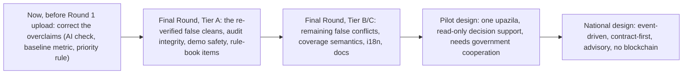
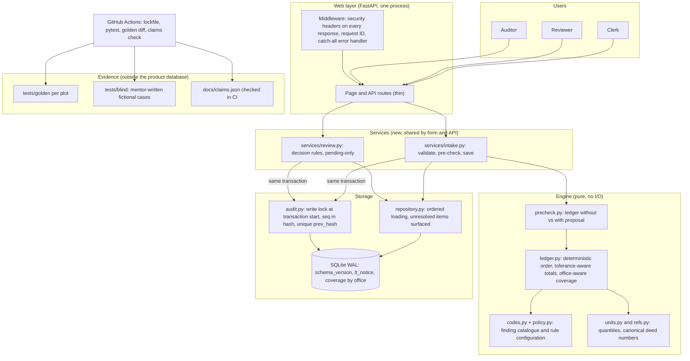
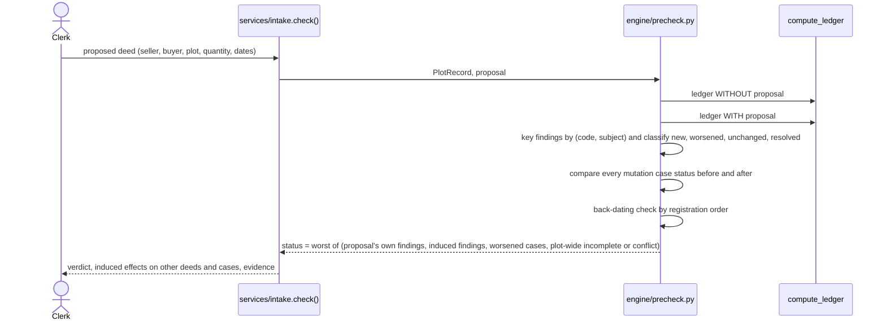
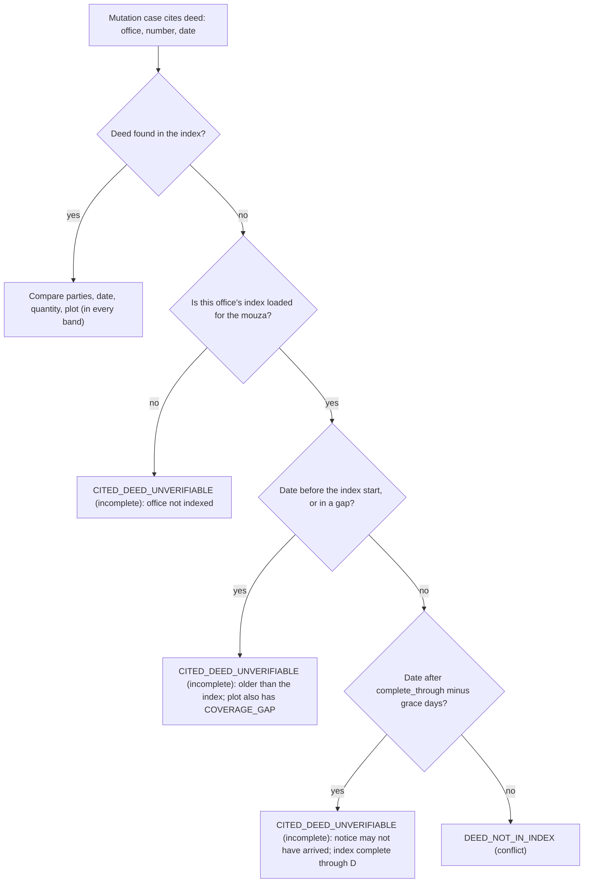
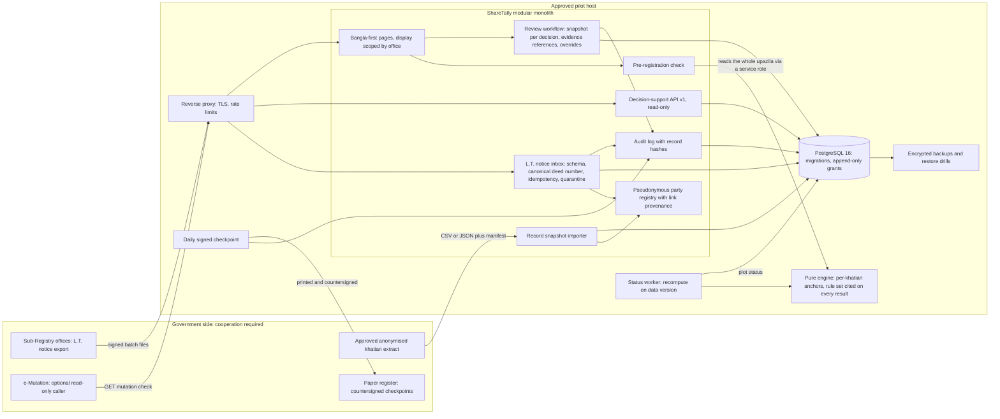
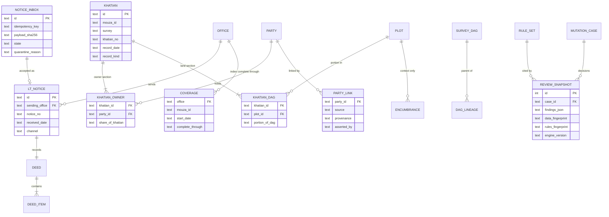
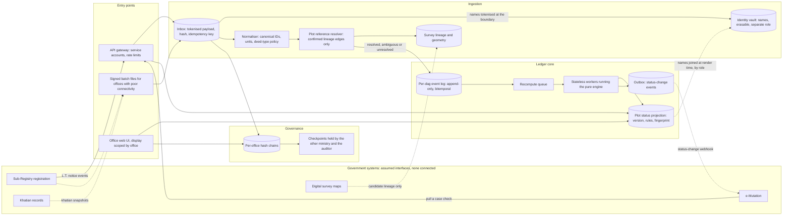

# ShareTally improvement architecture and roadmap

Status: **proposal**, 15 October 2026. Companion documents: [architecture.md](architecture.md) (as built), [audit-2026-10-15.md](audit-2026-10-15.md) (evidence), [adr/](adr/) (decisions).

> **How this was produced.** Four audit agents read the code, ran the tests and probed it with synthetic data. Three design agents then proposed improvement architectures for three horizons, and three adversarial reviewers critiqued those proposals against the code, feasibility, the rule book and Bangladesh land practice. This document is the synthesis, with the reviewers' corrections applied. All of it was generated with Claude Code (Claude Opus 5.5) and must be disclosed as AI-assisted. Legal points are listed as open questions for the faculty mentor (section 8), not as facts.

Contents: [1 Summary](#1-summary) · [2 Principles](#2-principles-every-change-must-keep) · [3 What the audit found](#3-what-the-audit-found) · [4 Horizon 1: Final Round](#4-horizon-1--final-round) · [5 Horizon 2: one-upazila pilot](#5-horizon-2--one-upazila-pilot) · [6 Horizon 3: national scale](#6-horizon-3--national-scale-and-interoperability) · [7 Cross-cutting roadmaps](#7-cross-cutting-roadmaps) · [8 Open questions](#8-open-questions-for-mentors-and-legal-review) · [9 Traceability](#9-traceability-weakness--improvement)

---

## 1. Summary

The prototype's idea holds up: a per-plot share ledger is a sound, explainable way to catch a second sale while the khatian is stale. The audit found the implementation has **real correctness gaps exactly where P3 matters**, plus integrity and honesty issues that a sharp judge could expose. Seven of them were reproduced independently:

| Re-verified finding | What happens today |
| --- | --- |
| ENG-1 back-dated proposal | A second sale given an earlier execution date shows **No conflict** to the clerk; once saved, the *earlier honest* deed is flagged instead. |
| ENG-2 "already reflected" gate | A deed executed before the khatian date but registered after it is treated as already reflected, so a later double sale reads only as Attention. |
| ENG-4 rounded khatian | Holdings written 16.67 + 16.67 + 16.67 on a 50-decimal plot raise a plot-wide **Conflict** on every case. |
| DATA-2 late notice | A mutation citing a deed whose L.T. notice has not arrived yet gets **Conflict** (deed not in index) instead of Incomplete. |
| DATA-3 joint deed | When co-owners sell together in one deed, one seller's case gets a false **Conflict**. |
| AI-1 fact-check overclaim | The draft check catches digit strings only; number words, swapped values and ownership claims pass, while five documents say it rejects "any number not in the facts". |
| WEB-2 audit fork | Audit appends are not serialised: with concurrent writers (threadpool handlers or a second worker) the chain forks and the auditor screen reports "chain broken" with no tampering. Today's single-process async handlers keep this latent, but the WEB-1 fix (F-05) would expose it. Separately, a decision or notice is committed before its audit row. |

The documentation review that checked these documents against the code found two more defects, also reproduced (register addendum): a mutation case filed after the demo clock is shown as **No conflict** because the engine never evaluated it (VER-1), and the clerk's check can disagree with the ledger stored after saving (VER-2).

Recommended path:

| Horizon | Goal | Who can do it | Effort (estimate) |
| --- | --- | --- | --- |
| Final Round | A correct, honest, demo-safe prototype the two students can explain | The team, on synthetic data | Tier A about 12–25 student-days at the scale in section 4; Tier B about 7–14 more. Cut from the bottom of each tier if the date is near |
| Pilot | Supervised decision support in one AC (Land) office | Team plus an institutional operator, only with government data agreements | Months; no date can be promised |
| National | Many upazilas, contract-first integration | Government programme | Multi-year; design only |

## 2. Principles every change must keep

1. **Missing, unresolved or unmodelled input is never reported as clean.** It is Incomplete, or Not checked when the check cannot run.
2. **Advisory, never decisive.** ShareTally never decides ownership, never labels a person fraudulent and never blocks a registration or mutation by itself.
3. **Deterministic and explainable.** Every status comes from exact arithmetic and named rules that both students can walk through. AI never sets a status.
4. **Evidence over assertion.** Every finding cites source records. Every number in the README, the deck and the concept note traces to a generated file or a test.
5. **Synthetic data only** until an approved agreement exists; no portal access, scraping or live-system testing.
6. **Hashes prove "no change since a baseline", nothing more.** Wording about tamper evidence must say exactly that.

## 3. What the audit found

The full register (56 weaknesses: 13 high, 33 medium, 10 low) is in [audit-2026-10-15.md](audit-2026-10-15.md). By theme:

**False clean results (most serious for P3):** ENG-1 back-dated proposals; ENG-2 execution-date gate; DATA-1 deed items whose old-survey reference cannot be placed disappear silently; VER-1 cases filed after the demo clock default to No conflict; ENG-8 deed types the engine does not model can still move shares; ENG-3 / DATA-5 same-day ties and zero-padding decide who is flagged, and a re-entered notice is credited twice; ENG-7 an acre-denominated sale absorbs up to 0.5 decimal per acre that the same sale written in decimals reports as Conflict.

**Hidden conflicts:** ENG-11 an over-transfer reported only as Incomplete when the plot area is unknown (never clean, but the conflict is not shown).

**False conflicts:** ENG-4 rounded khatians and heir lists; DATA-2 late notices and other offices' deeds; DATA-3 / ENG-10 joint and multi-item deeds; ENG-9 / DATA-4 a dag whose khatians were updated at different dates; ENG-5 one over-transfer cascading into several unlinked conflicts with an inflated overflow figure.

**Evidence and integrity:** WEB-2 / DATA-8 audit fork and non-atomic writes; WEB-3 deleting the newest audit rows still verifies; WEB-4 anonymous users can grow the immutable log with typed usernames and IPs; DATA-6 no history, so a decision cannot be reproduced after later notices arrive; EVAL-1 / EVAL-2 the answer key lives in the product and the headline metrics are loosely defined.

**Demo and operations:** WEB-1 / OPS-2 blocking work in async handlers freezes the server during AI calls or logins; WEB-5 / WEB-14 anyone can lock the shared demo accounts, and the timing parity claim is false; OPS-1 / WEB-6 the Render blueprint still prints passwords and leaves paid AI open; WEB-12 no logging; REPRO-1 no lockfile or Python pin.

**Honesty of claims:** AI-1 the fact-check overclaim; EVAL-2 "8 of 12" mixes 5 conflict cases with 3 incomplete ones whose truth is unknown by design; DOC-1 required README sections are placeholders; AI-2 pseudonymisation by string replacement can leak name fragments, and VER-3 deed-text extraction sends names to the model unchanged; the submission presents execution-date priority as following Transfer of Property Act s.48, which is an uninterpreted legal point (Q1).

**Explainability and maintenance:** ENG-12 a 309-line `compute_ledger` with the code catalogue spread over three files; WEB-8 an 826-line `web.py` with two diverging copies of the check; WEB-10 / I18N-1 / WEB-11 Bangla and accessibility gaps; DOC-2 documentation gaps (this document set starts to close them).

## 4. Horizon 1 — Final Round

**Constraints.** Two students, part-time, before a Final Round whose date is not yet announced. No new runtime dependencies. Every change ships with a synthetic scenario whose expected result is written first. Effort: S ≤ 1 student-day, M = 2–4, L = 1–2 weeks.

### 4.1 Do now, before the Round 1 upload (about 2–3 hours)

These are corrections to claims already in the submission, so they should not wait:

| ID | Change | Fixes |
| --- | --- | --- |
| F-00a | Replace "rejects any number not in the facts" with "rejects drafts containing a digit sequence that is not in the engine's facts, an unknown person token, or a listed accusatory word" in README, submission text, concept note (HTML and re-exported PDF), deck (HTML and PDF), demo script, `case.html`, `about.html`, the `ai.py` docstring and the success label returned by `ai.draft_notice` ("numbers match engine facts", shown by `app.js`). | AI-1 |
| F-00b | State the baseline as: "a khatian-only check would clear 5 of the 6 conflict cases (and 3 of the 6 incomplete cases, whose ground truth is unknown by design)", and split `khatian_only_baseline` by expected status so `templates/evaluation.html` and the regenerated `docs/evaluation.md` print the same figures. | EVAL-2 |
| F-00c | In `render.yaml` set `SHARETALLY_AI=0` and decide the login policy (public demo passwords stated as public values, or hidden). | OPS-1, WEB-6 |
| F-00d | Reword "earlier transfers keep priority, as in Transfer of Property Act s.48" to "earlier transfers, by execution date, keep priority — a design choice; whether execution or registration date decides priority is an open question for our mentor" in README, concept note (HTML and PDF), deck, `about.html` and the demo script. | Q1 |

### 4.2 Target architecture for the Final Round

The stack stays the same (one process, SQLite WAL, Jinja2, pure engine). The changes add a pre-check service, an explicit rule configuration and catalogue, office-aware coverage, a safe audit chain and evidence kept outside the product.

### 4.3 Tier A — must do before the Final Round (about 12–25 student-days)

Five M items and five S items at the scale above. Listed in priority order: if the Final Round comes sooner, stop at the line you reach, except F-08, which the rule book requires and is always done.

| ID | Improvement | Fixes | Size | Design notes |
| --- | --- | --- | --- | --- |
| F-01 | **Safety net first**: per-plot golden snapshots (`tests/golden/<plot>.json`, full findings, facts and rows), GitHub Actions running pytest, a lockfile and a Python pin (3.14, the only version tested), hermetic `conftest` (clear `SHARETALLY_*` env vars). | TEST-1, REPRO-1 | M | One file per plot avoids merge conflicts. Known defects get `xfail(strict=True)` referencing their fix, so CI turns red the moment they are fixed. Push the repository to GitHub first. |
| F-02 | **Pre-registration check as a ledger diff**, one implementation for form and API. | ENG-1, WEB-8 | M | See 4.6. |
| F-03 | **"Already reflected" decided by registration date**, applied to proposals too, plus a visible caveat when reflection is unconfirmed. | ENG-2, VER-2 | S | A transfer is pre-record only if `registration_date <= record_date`, and proposals go through the same gate so the check and the saved ledger agree. If no approved mutation cites a pre-record deed, add `PRE_RECORD_UNCONFIRMED`: incomplete when the same seller has a later transfer on the dag, otherwise attention — a survey khatian may not reflect deeds registered during attestation (Q3). |
| F-18 | **"Not checked" instead of a default No conflict**: a case the engine did not evaluate (for example, filed after the demo clock) gets a `NOT_CHECKED` status in the queue, case page and decision guard, never `NO_CONFLICT`. | VER-1 | S | Replace every `case_status.get(id, "NO_CONFLICT")` in `web.py` with an explicit not-checked state. |
| F-14 | **Nothing silently dropped**: a `CHECK` that an item has a plot or a reference; an item whose reference resolves nowhere gives `UNRESOLVED_REFERENCE` (incomplete, plot-wide) on every plot in the item's mouza where the seller is a recorded holder, or on every plot in the mouza if the seller holds none; share quantities are processed even when the area is unknown. | DATA-1, ENG-11 | S | Keep the clerk's chosen plot next to the deed's own wording. |
| F-04 | **Audit chain integrity**: take the write lock at the start of `db.transaction()` (`BEGIN IMMEDIATE`), write domain rows and the audit row in that one transaction, include `seq` in the hash under a `hash_version`, add `UNIQUE(prev_hash)`. Keep failed anonymous logins out of the chain (prunable `login_attempt` plus periodic aggregate entries). Store a data fingerprint, engine version and rules version with each review, and export the head hash outside the database at every rehearsal and at the freeze. | WEB-2, DATA-8, WEB-4; partly WEB-3 and DATA-6 | M | Taking the lock first avoids the lock-order hazard a reviewer found. Changing the hash formula starts a new chain segment whose first entry commits to the old head. An exported head detects truncation only back to the last export. |
| F-05 | **Non-blocking request path**: run SQLite work, PBKDF2 and AI calls in the threadpool (or make handlers plain `def`); AI timeout 10–15 s with no retries. | WEB-1, OPS-2 | S | Do F-04 first, because the threadpool turns the latent audit race into a real one. Test: `/healthz` answers in under 200 ms while a stubbed slow AI call runs. |
| F-06 | **Judging-safe login**: throttle on (username, IP) with a progressive delay instead of a hard lockout per username, clear on success, dummy hash at the configured iteration count, trust only the platform proxy's forwarded address. | WEB-5, WEB-14, OPS-3 (proxy trust) | S | Check Render's documentation for how it sets `X-Forwarded-For`; do not probe it. |
| F-07 | **Answer key out of the product**: move expectations and scenario titles to `tests/scenarios/`; reviewers no longer see "Second sale while…" next to the data. Run a **blind pack** once. | EVAL-1, EVAL-2 | M | Blind brief: fictional people and places only, no real case or file, names carry markers; the mentor writes about 10 stories with the expected status and a plain-language reason, committed before the first run; publish the result as it comes out, misses included. |
| F-08 | **Rule-book package**: README "Changes since Round 1", AI disclosure in the students' own words (including the AI-generated audit, plan and any Final Round code), team table, deck ≤ 10 slides, demo script v2, rehearsals. | DOC-1 | M | The team writes these; nothing here may be invented. Anything a student cannot explain is cut before the freeze. |

### 4.4 Tier B — should do (about 7–14 student-days, in this order)

| ID | Improvement | Fixes | Size | Design notes |
| --- | --- | --- | --- | --- |
| F-10 | **Deterministic order and canonical deed numbers**: sort key `(execution_date, kind, registration_date, proposed, office, reg_year, serial, item_id)`; sort every input list on entry; rows tie-broken by `source_id`; `UNIQUE(office, reg_year, serial)`. Same-day transfers that together exceed the holding stay **Conflict** (`OVER_TRANSFER`, subtype `same_day_priority_undetermined`, naming every deed). | ENG-3, DATA-5 | M | The critique was right that downgrading to Incomplete would hide a certain over-transfer; only *which* buyer bears the shortfall is undetermined. |
| F-11 | **Tolerance-aware totals**: khatian and heir totals compared with the sum of their parts' tolerances; when a heir list is accepted within tolerance, the estate's rounding remainder is kept as an explicit unallocated balance. | ENG-4 | S | With today's precision floor, ".3333 share" × 3 passes and ".333" × 3 does not; changing that floor is a policy decision for the mentors (Q5). |
| F-12 | **Joint and multi-item deeds**: `transfers_by_deed` becomes a list. A case matches the deed's items that have its buyer: if one item's seller equals the case's transferor, the quantity is compared with that item (per-seller application); otherwise, if the transferor is any of the deed's sellers, with the sum of those items (joint application). One `RECORD_LAG` per deed. | DATA-3, ENG-10 | S | Add one scenario for each shape. Comparing every case with the sum would make the reproduced per-seller case worse, not better. |
| F-13 | **Office-aware coverage** with three bands (see 4.7). | DATA-2 | M | Removes the most likely false Conflict in Q&A ("what if the notice is late?"). |
| F-09 | **Claims register and draft contracts**: `docs/claims.json` plus a CI check that every number in the README, deck and concept note matches a generated file or test; draft JSON Schemas for the L.T. notice and the check response. | EVAL-2, DATA-10, WEB-9 | S | Principle 4 depends on the claims register. The schemas are published as drafts, not as an integration that exists. |
| F-15 | **Deed-type policy (provisional, pending Q7)**: types other than sale and gift → `UNSUPPORTED_EVENT` (incomplete, plot-wide, not applied). A configurable list, filled only from the mentor's answer to Q7, may later mark specific instruments as non-title context (attention, never moves shares). | ENG-8 | S | Until Q7 is answered, a mortgage on the dag makes its cases Incomplete; that is the price of not guessing a legal classification. |
| F-16 | **Mixed record dates**: store each holding's khatian date; if a dag's holdings have different dates, emit `MIXED_RECORD_DATES` (incomplete). | ENG-9, DATA-4 | S | Cheap detection now; full per-khatian replay is pilot work. |
| F-17 | **Schema guardrails and rebuild-on-change**: primary keys on `crosswalk` and `heir`; `CHECK (date(col) IS NOT NULL AND col = date(col))` on required dates and `CHECK (col IS NULL OR (date(col) IS NOT NULL AND col = date(col)))` on nullable ones (`decided_date`, coverage end); approved ⇒ decided date; seller ≠ buyer; `meta.schema_version` and `dataset_hash`; bootstrap refuses a stale demo database or reseeds on request. | DATA-7, DATA-9 | S | The plain `CHECK (col = date(col))` form does not reject bad dates in SQLite (a reviewer verified this). |

### 4.5 Tier C — could do, otherwise "next steps"

`SELLER_RECORDED_DECEASED` after adding a death date distinct from the certificate date (ENG-6) · finding catalogue `codes.py` and `policy.py`, move-only (ENG-12, ENG-14) · property tests (4.8) · server-side language choice and accessibility fixes for intake, errors and the case page (WEB-10, WEB-11) · request ID, catch-all handler with security headers, `/healthz` doing `SELECT 1` (WEB-12) · AI fixes: pseudonymise at the source, merge extraction instead of replacing, show disagreements, handle missing keys, and either tokenise names before deed-text extraction or state plainly that pasted text is sent as written (AI-2, AI-3, AI-5, VER-3) · "No conflict in supplied records" on the short labels in the queue, plot list and dashboard · runbook, data dictionary, CONTRIBUTING with a "new finding code" checklist, CHANGELOG (DOC-2).

**Deferred past the Final Round, with reasons:** full `web/` package split (only the `services/` extraction is needed now; a late move risks the frozen demo); splitting `compute_ledger` into phases (same reason; do it behind the golden tests later); cascade root-cause linking (ENG-5; adds state to explain; the seeded demo has no cascade); unit-independent tolerance (ENG-7; needs a policy decision first (Q5), and any version must keep S16 passing); parameterised generator and fault-injection benchmark (GEN-1; self-graded, weaker than the blind pack); slot-based AI drafting (AI stays off for the demo); typed `/api/v1` and import CLI (F-09 publishes contracts as drafts instead); two-person overrides (pilot); load test and AI telemetry (AI-4); materialised status and query batching (WEB-13).

### 4.6 Design: the pre-registration check as a ledger diff (F-02)

- **Subject, not related set.** A finding is keyed by the transfer, case or holding it is about. Keying by the related set misattributes existing findings to the proposal (a reviewer reproduced this).
- **Back-dating rule, by registration order.** Flag transfer *T* when another transfer *U* by the same seller on the dag has `U.registration_date < T.registration_date` and `T.execution_date < U.execution_date`: *T* is replayed ahead of a deed registered before it. The finding is **attention** level and lands on *T*, in neutral wording ("executed before deed U, but registered after it"); the verdict is raised only by an induced `OVER_TRANSFER`. Same-day executions are handled by F-10 (`same_day_priority_undetermined`), not here. Comparing *T*'s execution date with *U*'s registration date instead would flag ordinary sales whose execution-to-registration windows merely overlap.
- **After saving**, the stored ledger attaches the back-dating finding to the later-registered deed, and the `OVER_TRANSFER` explanation names the deed that took priority by execution date. Under execution-date priority the earlier-registered deed and its mutation case **still show Conflict**; whether that is right depends on Q1. F-02 fixes what the clerk sees, not that outcome.
- **Realistic demo scenario.** The audit's probe used a 7-year gap between execution and registration, which a land-domain judge would reject. Rebuild it inside the window the law allows (Q2).

### 4.7 Design: coverage in three bands (F-13)

For **replay coverage** (the plot's own history), gaps before the index start or between periods are `COVERAGE_GAP` (incomplete), while the trailing window between `complete_through` and today is not a gap: every result states `records_complete_through` per office instead. The trailing window is never a reason to skip a **cited** deed: a found deed is still compared, and a missing one is unverifiable, so no new false-clean path opens. Scenario S05 keeps its expected codes (`CITED_DEED_UNVERIFIABLE`, `COVERAGE_GAP`); the explanation text gains the reason.

`coverage` becomes `(office, mouza_id, start_date, complete_through, note)`, and the L.T. notice becomes its own table (`lt_notice`: deed, sending office, notice number, received date, received by, channel). Grace days are a labelled demo assumption, never a legal or statistical claim. Whether the District Registrar's office also registers deeds for these mouzas is open question Q4; until confirmed, a mouza counts as complete through date D only if every office with jurisdiction is.

### 4.8 Evidence and testing for the Final Round

- **Golden snapshots** guard every engine change (F-01). A change to a golden file is reviewed as a deliberate behaviour change and logged in the CHANGELOG.
- **Blind pack** (F-07) is reported separately from the designed scenarios; later fixes for its misses are listed as post-hoc.
- **Property tests**, restated after the critique: conservation (the sum of final balances equals the baseline total exactly for every input, including over-transfers, because debits are capped; once F-11 accepts heir lists within tolerance, the estate's rounding remainder is counted as an explicit unallocated balance); full order-invariance of canonical output under permutations of every input list; **shrinking coverage never yields No conflict or Attention when the original result was Incomplete or Conflict** (the original "never cleaner" property is false by design, because a covered Conflict can legitimately become Incomplete); every not-applied row carries a code.
- **Claims register**: `docs/claims.json` maps each number in the README, deck and concept note to a generated file or test; CI fails on a mismatch.
- **Bangla number words**, if the AI check is extended: matching needs Bengali-aware boundaries (`(?<![ঀ-৿])…(?![ঀ-৿])`), because naive substrings match "শত" inside "শতাংশ" and would silently disable the AI path.

### 4.9 Schedule (relative; the Final Round date is unknown)

| When | Student A (engine) | Student B (platform and evidence) |
| --- | --- | --- |
| Week 1 | Push to GitHub; F-01 golden snapshots; F-02 pre-check diff | F-01 CI, lockfile, pin; send the blind brief to the mentor; F-04 audit integrity |
| Week 2 | F-03 registration-date gate, F-18 not-checked status, F-14 nothing dropped | F-05 non-blocking, F-06 login safety, F-07 answer key out and blind pack run |
| Week 3 | F-10, F-11, F-12 | F-13 coverage bands, F-09 claims register and draft schemas |
| Week 4 | F-15, F-16, F-17 | Tier C items in order, documentation |
| Freeze (3–4 days before) | Explain-swap sessions with the faculty mentor | F-08 package, five rehearsals on a local instance with AI off |

This assumes the middle of each estimate and part-time work; if the Final Round is announced sooner, finish Tier A in its listed order and move the rest to the README's known limits. Before the sprint, extract `services/intake.py` and `services/review.py` as a move-only change, so that both students are not editing the 826-line `web.py` at once.

## 5. Horizon 2 — one-upazila pilot

**Scope.** Read-only decision support beside the e-Mutation workflow in one AC (Land) office, fed by L.T. notices from one or two Sub-Registry offices and an approved, anonymised khatian extract. ShareTally never writes to a government system and never decides a case.

**Needs government cooperation; none exists today:** a data-sharing approval and data-protection impact assessment; an anonymised extract with consistent pseudonymous keys; an agreed L.T. notice format and transport; approved hosting with custody of backups and keys; an official to approve rule sets and countersign checkpoints; staff time and access to the paper L.T. register; optionally an identity provider and an e-Mutation vendor willing to call the check API.

**Ownership.** The scope (PostgreSQL, ingestion, scoping, backups, checkpoints, evaluation protocol) exceeds two part-time students. Name an institutional owner and operator (a university lab or the Ministry's IT cell) at stage 0, and write the runbook for them.

### 5.1 Target architecture

### 5.2 Data model evolution

Key changes: the khatian is a two-part record (owners' shares of the khatian × the khatian's portion of each dag gives a dag share); the L.T. notice and its inbox carry provenance; coverage is per office with a "complete through" date; survey lineage records portions, source and confirmation; encumbrances are context that never move shares; every decision stores a snapshot of what the reviewer saw.

### 5.3 Key designs, with the reviewers' corrections

| Topic | Design |
| --- | --- |
| Notice inbox | Every notice, digital or paper-keyed, enters through one inbox: schema validation, canonical deed number, idempotency key, provenance. **A quarantined notice pins `complete_through` for its office and mouza** at or before its registration date until resolved, and plots it could touch show `NOTICE_QUARANTINED` (incomplete). Without this, quarantine would create a new false-clean path. |
| Scoping | Scope what users **see and do**, not what the engine **reads**. Engine and pre-check reads run under a service role covering the whole pilot upazila; otherwise a seller selling the same share through two Sub-Registry offices — the cross-office double sale P3 targets — would read clean. |
| Khatian anchors | Replay each holder's events after their own khatian's record date; debit on the seller's anchor, credit on the buyer's. Carry `record_kind` (survey final publication vs mutation order). Unresolvable anchor conflicts give Incomplete. |
| Party identity | Historic khatians carry names, not a shared identifier. Each party link records its provenance (`provider_exact`, `provider_name_match`, `clerk_asserted`); name matches are assertions needing evidence; an unmatched party gives `PARTY_UNMATCHED` (incomplete). Measure the unmatched rate before trusting results. |
| Inheritance and case status | Name the sources: inheritance entered by the reviewer from the mutation file with evidence references; a daily status file of mutation cases including decided ones. Report Incomplete caused by missing inheritance or case data as its own category. |
| Rule sets | Versioned data approved by a land official, with a basis per code (verified citation or "design policy"). Conflict and Incomplete codes cannot be switched off. Every result cites its rule set. |
| Decisions | Store the full findings JSON, engine version, rule set, data fingerprint and rules fingerprint with each decision; show "records changed" and "rules changed" separately. Store evidence **references** (type, number, date), never scans. |
| Overrides | An AC (Land) office has no peer reviewer of equal rank, so map separation of duties to existing roles (for example, an override of a Conflict requires a recorded second sign-off by a designated supervisor) and confirm the role model with the office. |
| Audit | Serialised chain with record hashes; daily signed checkpoint (head, sequence, count), printed and countersigned on paper. No blockchain. |
| Privacy | Pseudonymous keys from the data provider; no external AI on pilot data whatever the configuration; search by name restricted; read access to case pages logged. |
| Operations | One modular monolith on one approved VM; PostgreSQL only (freeze the SQLite demo at the Final Round tag); a simple operations page and e-mail alerts rather than a metrics stack; nightly encrypted backups with monthly restore drills. |

### 5.4 Rollout and evaluation

```mermaid
flowchart LR
    S0["0. Cooperation track: approvals, data, hosting, owner"] --> S1["1. Final Round fixes (Horizon 1)"]
    S1 --> S2["2. Data foundation on synthetic pilot-shaped data"]
    S2 --> S3["3. Ingestion, scoping, privacy, operations"]
    S3 --> S4["4. Governance: rule sets, snapshots, overrides, checkpoints"]
    S4 --> S5["5. Dress rehearsal, blind pack, restore drill"]
    S5 --> S6["6. Dry run on approved extract, internal only"]
    S6 --> S7["7. Shadow mode with safety escalation"]
    S7 --> S8["8. Advisory mode, then go or no-go with officials"]
```

The evaluation protocol is registered before stage 6: Conflict precision per code as adjudicated by officers; a sampled audit of results shown as clean, with confidence intervals; the Incomplete share by cause; digital notice completeness against the paper L.T. register; reviewer time per case with and without the tool; override use and staleness. Unfavourable results are published too.

**Shadow-mode safety.** Hiding results from reviewers must not mean hiding a likely double sale while a mutation proceeds. A designated officer who does not review the cases sees shadow Conflicts within a fixed time, and a written agreement (reviewed by the mentor or a lawyer) states that findings are record-consistency signals, not evidence of an offence.

## 6. Horizon 3 — national scale and interoperability

**Principles.** Missing or unmodelled input is Incomplete, and every response states `records_complete_through` per office. The service is advisory and fails visibly: if a check cannot run, the result is **Not checked**, never clean. Tamper evidence is per-office hash chains with checkpoints held by parties the operator does not control. No public API is known for the Sub-Registry, e-Mutation, DLRMS, succession records or digital survey maps, so every interface below is a contract ShareTally would publish, marked **assumption**.

| Decision | Choice | Why |
| --- | --- | --- |
| Storage | One PostgreSQL/PostGIS cluster holding inbox, per-dag event log, work queue (`SKIP LOCKED`), projection and outbox | No streaming platform or distributed ledger is needed until a measured load says otherwise |
| Compute | Replay each dag in full with the pure engine; cache by (dag version, rule set) with `valid_until` for time-based rules | Replay takes milliseconds per dag on synthetic data; back-dated events would invalidate incremental deltas anyway. Keep running outflow totals so pathological dags stay linear (ENG-13) |
| Trailing window | The days between `complete_through` and today are reported as a fact on every response, not as a gap | Otherwise a live feed, which always trails today, would make every check Incomplete |
| Privacy | Tokenise names at the inbox; raw payloads in an erasable, access-controlled vault store; append-only stores hold tokens and hashes only | An immutable store holding names would conflict with erasure and data protection |
| Survey lineage | GIS overlays propose candidate edges; a surveyor confirms; the ledger follows confirmed edges only | Geometry alone must not attribute a deed |
| Decisions | Mutation decisions stay in e-Mutation (assumption); ShareTally records the officer's override reason fed back with the case | Matches how an AC (Land) office decides; ShareTally stays advisory |
| Heirs | Treat a heirship (warish) certificate as evidence of who the heirs are; take fractions from an approved mutation order or khatian lines | Whether any feed of heir fractions exists is itself an assumption (Q6) |
| Citizen check (P5) | Later, only with the seller's consent and a legal basis | Privacy and stalking risk |

**Not building at any horizon:** blockchain or any distributed ledger; automatic blocking of registrations or automatic mutation; ownership decisions, fraud scores or machine-learning fraud prediction; computation of inheritance shares under personal law; scraping or probing government systems; claims of APIs, partnerships or capacity figures that do not exist or were not measured.

## 7. Cross-cutting roadmaps

| Area | Final Round | Pilot | National |
| --- | --- | --- | --- |
| API | Keep `/api/*`; publish draft JSON Schemas for the L.T. notice and check response | `/api/v1` with typed request and response models, one error envelope, pagination, OpenAPI behind login | Gateway, service accounts, idempotency keys, outbox webhooks |
| Security | Audit integrity (F-04), login safety (F-06), no secrets on the login page | Office-scoped display, MFA, signed checkpoints, append-only database grants | Per-office chains, cross-witnessed checkpoints, read logging |
| AI | Off on the public demo; claims corrected; pseudonymise at source | Off on pilot data whatever the configuration | Optional drafting only, with a versioned evaluation as release gate |
| Evaluation | Golden snapshots, blind pack, restated property tests, claims register | Pre-registered protocol, shadow mode, officer adjudication | Continuous monitoring of Incomplete by cause and override rates |
| Bangla and accessibility | Server-side language choice; intake, errors and case page translated; contrast, focus, skip link, field-level errors | Bangla-first everywhere; WCAG AA on core task pages | Same, plus a screen-reader test with office staff |
| Documentation | This set; runbook, data dictionary, CONTRIBUTING, CHANGELOG | Pilot runbook for the operator; training pack | Integration contracts marked as assumptions |

## 8. Open questions for mentors and legal review

| # | Question | Why it matters |
| --- | --- | --- |
| Q1 | When two registered sales of the same share compete, does priority follow execution date or registration date? (Registration Act s.47 and Transfer of Property Act s.48 are relevant; we have not interpreted them.) | Decides the replay order and the back-dating rule (F-02, F-10) |
| Q2 | What time is currently allowed between execution and presentation for registration (Registration Act ss. 23, 25 and later amendments)? | A realistic back-dating scenario and a possible "long execution gap" attention code |
| Q3 | For survey khatians (BS/BRS), which deeds does the final record reflect: those registered before attestation, or before final publication? | Defines `record_date` and the "already reflected" gate (F-03) |
| Q4 | Can deeds for these mouzas also be registered at the District Registrar's office? | Defines when a mouza's index is complete (F-13) |
| Q5 | What rounding should a khatian or heir list be allowed (e.g. ".333" vs ".3333")? | Tolerance policy (F-11) |
| Q6 | What document states heir fractions in practice, and is there any digital source of it? | Inheritance inputs for the pilot and national designs |
| Q7 | Which instruments move title and which do not (mortgage, agreement for sale, power of attorney, heba, exchange, partition)? | Deed-type policy (F-15) |

## 9. Traceability: weakness → improvement

| Weakness (see register) | Final Round | Pilot | National |
| --- | --- | --- | --- |
| ENG-1 back-dated proposal | F-02 (pre-check); after a save the earlier-registered deed still carries `OVER_TRANSFER` until Q1 is decided | — | contract semantics |
| ENG-2 execution-date gate | F-03 | khatian anchors, `record_kind` | same |
| VER-1 unevaluated case shown as No conflict | F-18 | Not checked status | Not checked in every response |
| VER-2 check and saved ledger disagree | F-03 (same gate for proposals) | — | — |
| ENG-3, DATA-5 order and deed numbers | F-10 | inbox canonicalisation | normaliser |
| ENG-4 rounded totals | F-11 | rule set policy | same |
| ENG-5 cascades | deferred | root-cause linking | same |
| ENG-6 seller recorded deceased | Tier C | death date in schema | same |
| ENG-7 unit-dependent tolerance | deferred (policy first) | rule set | same |
| ENG-8 unmodelled deed types | F-15 | typed events after legal review | same |
| ENG-9, DATA-4 khatian dates | F-16 detection | per-khatian anchors | same |
| ENG-10, DATA-3 joint deeds | F-12 | — | — |
| ENG-11, DATA-1 dropped items | F-14 | inbox quarantine pins coverage | resolver |
| ENG-12, ENG-14 structure and rule recording | Tier C (catalogue) | rule sets cited on results | projection keyed by rule set |
| ENG-13 performance | — | worker, running totals | projection cache |
| DATA-2 coverage | F-13 | per-office coverage | trailing-window fact |
| DATA-6 history | partly F-04 (review fingerprints) | decision snapshots, `recorded_at` | bitemporal event log |
| DATA-7, DATA-9 integrity and migrations | F-17 | PostgreSQL migrations | same |
| DATA-10 import | F-09 draft contract | record importer, inbox | batch adapter |
| DATA-11 lineage, encumbrances | — | lineage with portions; encumbrance context | GIS-proposed, surveyor-confirmed |
| EVAL-1, EVAL-2 evaluation | F-07, F-00b, F-09, property tests | pre-registered protocol | monitoring |
| GEN-1 generator | — (deferred with the fault-injection benchmark) | pilot-shaped generator | feed simulator |
| WEB-1, OPS-2 blocking | F-05 | worker | stateless workers |
| WEB-2, DATA-8, WEB-4 audit | F-04 | signed checkpoints | cross-witnessed checkpoints |
| WEB-3 tail deletion | partly F-04 (head exported at rehearsals and freeze) | signed daily checkpoints | cross-witnessed checkpoints |
| WEB-5, WEB-14 login | F-06 | MFA | gateway |
| OPS-1, WEB-6 deployment secrets and AI cost | F-00c | proper hosting | gateway, per-office rate limits |
| WEB-7 authorization | pending-only decisions (`services/review.py`) | display scoping, override sign-off | office scoping |
| WEB-8 monolithic web.py | services extraction | modular monolith | services behind the API |
| WEB-9 API | F-09 draft schemas | `/api/v1` | contracts and gateway |
| WEB-10, WEB-11, I18N-1 Bangla and accessibility | Tier C | Bangla-first, WCAG AA | same |
| WEB-12 logging and errors | Tier C (logging basics) | operations page | observability |
| WEB-13 request cost | — (deferred) | materialised status, worker | projection cache |
| OPS-3 storage and proxy trust | F-06 (proxy trust) | durable storage, backups | availability and recovery design |
| AI-1, AI-2, AI-3, AI-5, VER-3 | F-00a, Tier C | AI off on pilot data | release-gated drafting |
| AI-4 measurement | — (deferred: AI telemetry) | — | versioned AI evaluation |
| TEST-1, TEST-2, REPRO-1 | F-01, property tests | CI on PostgreSQL | same |
| DOC-1, DOC-2 | F-08, this document set | operator runbook | contracts |
